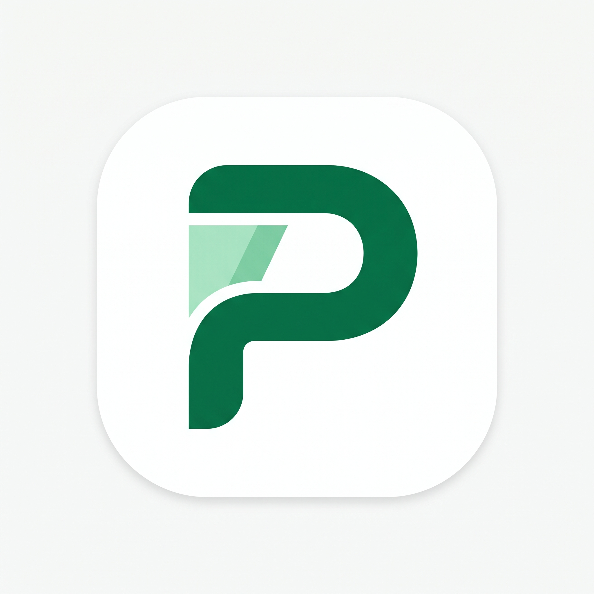

# Pookie POS

Offline-first point-of-sale app for Indonesian small businesses (UMKM). Built with Kotlin, Jetpack
Compose, Material 3, and Room.



## Features

Cashier
- Product search by name, SKU, or barcode, with quantity and price adjustment, line and invoice
  discounts, tax, and explicit currency rounding rules
- Camera barcode scanning and USB/Bluetooth HID scanner input, with manual code entry in the cashier
  and product form
- Tiered wholesale pricing, negotiated price overrides, and multi-unit products
- Payment methods: cash, QRIS, bank transfer, split payment, and customer debt (kasbon), with
  change and remaining-balance calculation
- Shift handover: the cashier header names the active cashier and opens, switches, or ends a shift
  with cash reconciliation; **More → Shift & Kasir** shows the active shift and its history
- QRIS: the merchant's static payload is converted on-device into a dynamic QR with the exact
  amount; no payment gateway is involved, so payment confirmation stays manual
- Receipt sharing as text, plus a receipt preview and test print from Settings
- Offline by default: no account, no sign-in, and no network access (the app does not request the
  `INTERNET` permission)

**Shift & cashier.** A shift is required before checkout; browsing the catalogue and building a cart
still work without one. Opening a shift needs no PIN, while closing, switching, or ending it
requires the owner PIN when PIN protection is enabled. Expected cash is
`startingCash + cashSales + cashDebtPayments − cashRefunds`; refunds are assumed cash in the MVP
because the return flow has no refund method. A non-zero variance must be confirmed before the shift
closes. Switching requires an empty cart, otherwise **Kosongkan & Ganti** asks for confirmation.
Each sale snapshots the cashier name, so a reprint names the cashier who made the sale.

Catalogue and stock
- Products with category, unit, cost price (HPP), selling price, tier pricing, and optional photo
- Multi-unit stock tracking with available, low-stock, out-of-stock, and oversold states

Customers and transactions
- Customer records with an optional contact picker, debts with partial payments and due dates
- Transaction history with filters and detail drill-down, plus a returns ledger

Reports
- Total sales, estimated net profit, HPP, transaction count, and average transaction for the
  selected range
- Sales chart and payment-method breakdown
- CSV and Excel (`.xlsx`) export through the system file picker, with a clear completion card that
  shows the saved file name and location plus **Open** and **Share** actions

Settings
- Store profile (store name, cashier name), tax rate, and rounding increment
- Bluetooth thermal printer: connection status, paired-device list, paper width, test print, and
  receipt preview
- Static QRIS image upload and replacement
- Backup and restore: export every database table to a single JSON file in `Download` and
  restore it back, with validation and a confirmation before data is replaced. Image files
  (product photos and the QRIS image) are referenced by path but not bundled, so copy them
  separately when moving to a new device
- Security: owner PIN with an offline recovery code, audit history, and PIN gating for sensitive
  actions such as profit/HPP visibility, discounts, exports, restores, tax changes, QRIS removal,
  and debt payments
- App language: Indonesian, English, and Simplified Chinese. The interface, receipts, printer
  output, and report exports follow the selected language
- About and privacy: app version and an in-app link to the privacy policy

## Known gaps

- **Returns exchange flow**: `ExchangeSettlement` and `settleExchange` exist with tests, but the
  returns UI does not use them.
- **Receipt PNG sharing**: sharing is `text/plain` only; the printed receipt does include the QRIS
  image when configured.
- **Google Drive backup** (the JSON backup is local only), **bulk shelf-label printing**, and
  **AdMob**: not implemented. `AdController` is wired to `NoAdsController`.
- **Baseline Profiles and cold-start measurement**: not configured or measured.

See [docs/prd-gaps.md](docs/prd-gaps.md) for the full audit against the PRD.

## Requirements

- Android 6.0 (API 23) or newer
- JDK 17 and Android SDK 36 for building

The default `java` on the development machine is JDK 8, so export JDK 17 before running Gradle:

```bash
export JAVA_HOME="/opt/homebrew/opt/openjdk@17/libexec/openjdk.jdk/Contents/Home"
```

## Build

```bash
./gradlew assembleDebug              # debug build, package id.umkm.pos.pro.debug
./gradlew testDebugUnitTest          # unit tests
./gradlew assembleRelease            # signed release APK
./gradlew bundleRelease              # signed release AAB for Google Play
./gradlew :app:connectedDebugAndroidTest \
  -Pandroid.injected.androidTest.leaveApksInstalledAfterRun=true  # keeps app data
./gradlew lintRelease                # lint; currently fails, see docs/prd-gaps.md
```

Release signing reads `keystore.properties` from the repository root:

```properties
storeFile=/absolute/path/to/upload-keystore.jks
storePassword=...
keyAlias=...
keyPassword=...
```

The file is gitignored. Without it the release build stays unsigned and cannot be uploaded to
Google Play.

Install a build on a connected device:

```bash
adb install -r --user 0 app/build/outputs/apk/release/app-release.apk
```

Pass `--user 0` on a device with a Secure Folder or a second profile so the app lands in the
owner's profile.

## Launcher icon

The launcher icon source is [`newicon.jpeg`](newicon.jpeg) at the repository root. Android assets
are generated from it:

- adaptive foreground: `app/src/main/res/drawable-xxxhdpi/ic_launcher_foreground.png`
- monochrome layer for themed icons: `app/src/main/res/drawable-xxxhdpi/ic_launcher_monochrome.png`
- legacy square and round icons: `app/src/main/res/mipmap-{mdpi,hdpi,xhdpi,xxhdpi,xxxhdpi}/`
- adaptive background: `#FCFFFE` in `app/src/main/res/values/ic_launcher_background.xml`

## Verification status

Verified on 22 October 2026:

| Check | Result |
| --- | --- |
| `testDebugUnitTest` | 642 tests, 0 failures |
| `connectedDebugAndroidTest` | 60 tests on the Samsung SM-S721B (59 passed, 1 expanded-device test skipped, 0 failed) |
| `assembleDebug` | Builds |
| `assembleRelease` | Builds with R8 and resource shrinking; launcher assets survive shrinking |
| `lintDebug` | 14 pre-existing errors and 57 warnings; see [docs/prd-gaps.md](docs/prd-gaps.md) |

The shift flow was exercised manually on the SM-S721B: open shift, cash sale, expected-cash update,
owner-PIN gate, non-empty-cart guard, non-zero variance confirmation, More card/history, and the
close form at 135% font. The
Lenovo TB321FU tablet was disconnected for the final shift run. The launcher icon was checked on
both devices in the previous pass. Legacy square and round icons were validated statically but not
exercised on API 23–25. Bluetooth printer and HID scanner paths have not been exercised on physical
hardware.

## Demo data

Debug builds only: open **Lainnya → Data Demo** to insert sample products and transactions. The
section is hidden in release builds by `BuildConfig.DEBUG`.

## Project layout

```
app/src/main/java/id/umkm/pos/pro/
  app/       application container and composition root
  core/      models and contracts (frozen shared API)
  data/      Room database, repositories, image store, demo seed
    backup/  JSON backup payload, codec, and export/import service
    file/    file sinks and file name helpers shared by exports and backups
  domain/    pricing, accounting, QRIS payload, use cases
  feature/   reports and export
  hardware/  Bluetooth/USB printer, HID scanner, receipt rendering
  monetization/admob/  AdController implementations (currently NoAdsController)
  ui/        Compose screens, components, theme, localization catalogues
docs/        product requirements, architecture, implementation status, publishing guide
```

## Documentation

- [docs/prd.md](docs/prd.md) — product requirements, the source of truth
- [docs/architecture.md](docs/architecture.md) — module layout and frozen contract decisions
- [docs/prd-gaps.md](docs/prd-gaps.md) — implementation status against the PRD
- [docs/design/barcode-scan.md](docs/design/barcode-scan.md) — barcode scanning design, states, and measured gates
- [docs/dev-environment.md](docs/dev-environment.md) — toolchain and build constraints
- [docs/playstore-release.md](docs/playstore-release.md) — Google Play release process
- [docs/privacy-policy.html](docs/privacy-policy.html) — privacy policy

## License

© 2026 Hadinata Jenta. All rights reserved.

Navigation icons are from [Lucide](https://lucide.dev), used under the ISC License.
